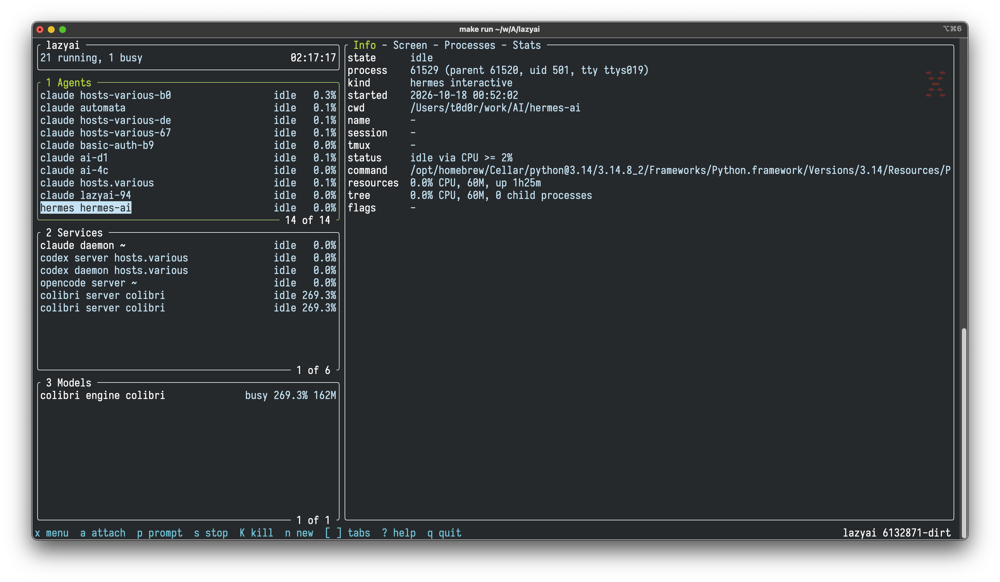

# lazyai



Control the AI coding agents running on this Mac from one terminal
dashboard: see what is running and whether it is busy, start new agents in
tmux, attach to them, type prompts into them, and stop them.

Supported agents: Claude Code, Codex, opencode, Gemini CLI, Qwen Code,
aider, cursor-agent, Hermes Agent, and the local model runtimes ollama and
Colibri (its `coli` launcher and native engines such as `qwen36`). Desktop
apps (Claude.app, Cursor.app) are ignored. Colibri is listed, watched and
stoppable, but started with its own tooling rather than `launch`.

Roles: `interactive`, `server`, `daemon`, `job` (batch work such as
`coli tune`), `engine` (a model inference process) and `helper` (hidden
unless `--all`).

## Install

```sh
brew install t0d0r/tap/lazyai
```

## Build

```sh
make build       # bin/lazyai
make check       # gofmt, go vet, tests
make run         # build and start the dashboard
make install     # copy to ~/.local/bin (PREFIX=... to change)
make help        # all targets
```

Requires macOS, Go 1.24 or newer, and tmux for launch, attach and send.

## Use

```sh
bin/lazyai                       # dashboard
bin/lazyai list                  # table; -all adds helper processes
bin/lazyai list -json            # machine-readable
bin/lazyai show claude-x         # details of one agent; -json too
bin/lazyai watch                 # agents, then changes as they happen
bin/lazyai watch -json | jq .    # one JSON event per line
bin/lazyai launch claude         # new Claude Code session in tmux, here
bin/lazyai launch -dir ~/work/AI/x -name x codex
bin/lazyai launch ollama run llama3.2
bin/lazyai attach claude-x
bin/lazyai send claude-x "run the tests"
bin/lazyai stop claude-x         # asks first; -yes skips, -force kills
bin/lazyai kill 12345            # same as stop -force
```

AGENT arguments accept a PID, a tmux session name (the `lazyai-` prefix
is optional) or a Claude Code session name.

Help works like any Unix tool: `lazyai -h`, `lazyai --help`,
`lazyai help COMMAND` and `lazyai COMMAND --help`. Options have long
and short forms (`--all`/`-a`, `--json`/`-j`, `--yes`/`-y`, ...) and may
follow arguments (`lazyai stop claude-x -y`), except for `launch` and
`send`, where everything after KIND or AGENT belongs to the agent or the
prompt. `lazyai --version` prints the git version it was built from.
Exit status is 0 on success, 1 on failure, 2 on a usage error.

## Dashboard

`lazyai` with no arguments opens a full-screen dashboard laid out like
lazydocker: Agents, Services and Models panels on the left, and tabs about
the selected agent on the right:

- Info: status, directory, session, tmux pane, resources, flags
- Screen: the agent's live tmux pane, following the bottom like a log
- Processes: everything the agent started, with CPU and memory
- Stats: CPU and memory charts for the agent and its children

Press `?` for all keys and `x` for a menu of actions on the selected
agent. The mouse works: click to select, wheel to scroll.

Every dashboard action also has a command:

| key          | action                                          | command             |
|--------------|-------------------------------------------------|---------------------|
| tab, h / l   | next / previous panel                           | -                   |
| j / k        | move, or scroll the main panel                  | -                   |
| ] / [        | next / previous tab                             | `show AGENT`        |
| a            | attach to the agent's tmux session              | `attach AGENT`      |
| p            | type a prompt into the agent and press Enter    | `send AGENT TEXT`   |
| n            | launch: `KIND [DIR] [NAME] [-- ARGS]`           | `launch`            |
| s / K        | stop (SIGTERM) / kill (SIGKILL), with y/N       | `stop` / `kill`     |
| H            | show or hide helper processes                   | `list --all`        |
| live view    | status durations and flags                      | `watch`             |
| x / ? / q    | menu / keybindings / quit                       | -                   |

To leave an attached agent and return to lazyai, press the tmux prefix
and `d` (ctrl+b d by default); the agent keeps running. Sessions started by
lazyai show this hint on the right of their tmux status line. If lazyai
itself runs inside tmux, use the prefix and `L` instead.

Attach, prompt and the Screen tab only work for agents running inside
tmux. Agents started in a plain terminal tab are listed and can be stopped,
but not driven.

Status comes from Claude Code's own session files when they exist
(`~/.claude/sessions/<pid>.json`); otherwise an agent is "busy" when it uses
2% CPU or more. FLAGS warns about high CPU for 30s, memory over 2 GiB, and
busy for over 30 minutes. `self` marks lazyai's own parent processes,
which cannot be stopped from it.

See `specs/` for the full behavior.

## Security

- lazyai only signals processes it classified as agents, owned by your
  user, and still matching the PID, command and start time it listed.
- Command lines are shown with values of key, token, secret and password
  flags replaced by `[redacted]`; the redaction is a heuristic, not a
  guarantee. Review `list -json` output before sharing it.
- `send` types text into an agent exactly as given; the agent then acts on
  it with its own permissions. Treat it like typing into that terminal.
- Claude Code `*.key` files next to the session metadata are never read.

## License

BSD 2-Clause (the FreeBSD license). See `LICENSE`.
